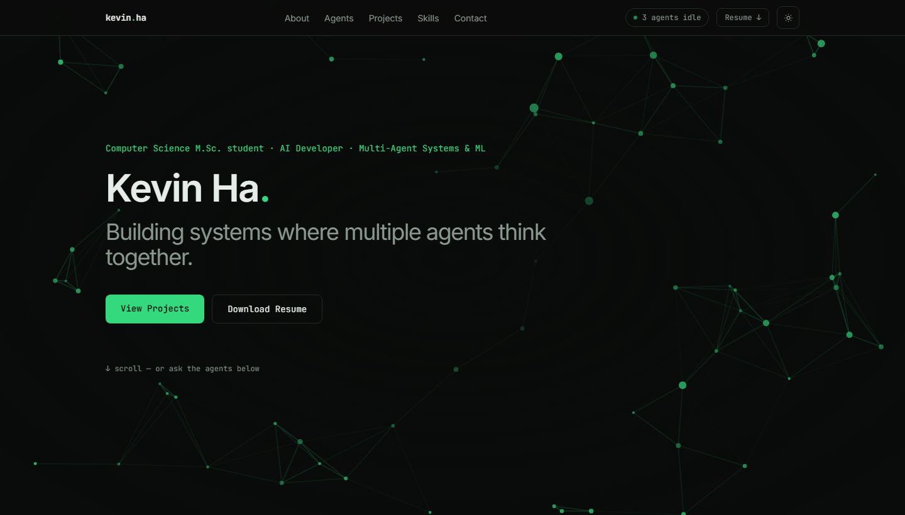

# Kevin Ha — Portfolio

**Live site: [kevinha.vercel.app](https://kevinha.vercel.app)**



My personal portfolio, built around a multi-agent theme: an ambient
agent-network hero, a skills node graph, a project grid and a working
**"Ask My Agents"** demo. Ask it about my projects, skills or experience and a
small team of agents answers in plain language, filters the project grid to
match, and shows each agent's work in a live log.

What makes the demo more than a chatbot wrapper:

- **A real multi-agent design, measured against the simple alternative.** A
  Planner and a Synthesizer run in parallel, and deterministic code grounds and
  checks their output. An eval harness compares this against a single zero-shot
  call on accuracy, refusals, latency and cost ([results](#evaluation)).
- **Built to be public.** A shared-secret proxy, rate limits, layered
  guardrails with fixed refusals, a privacy rule for personal data and a hard
  spend cap keep a public LLM endpoint safe and cheap ([details](#safety-and-abuse-protection)).
- **It never breaks.** If the backend is asleep, rate limited or down, a
  client-side rule-based pipeline answers instead.

Stack: Next.js, TypeScript, Tailwind v4 and Framer Motion on Vercel; Python,
FastAPI and LangChain on Render; DeepSeek through OpenRouter.

## How the agents work

The backend runs a LangChain pipeline over the same JSON knowledge base as the
frontend (`frontend/data`), so both tiers answer from identical data.

```
input screen (regex, instant: injection, clearly harmful requests)
    │
    ├── Planner (LLM, 4 short fields)  ──  Retriever (deterministic)
    │     router + semantic guard            exact tag/type matches
    │                                               │
    └── Synthesizer (LLM, whole KB) ────────────────┴── Verifier (deterministic)
          starts at the same time                      grounds ids, orders, screens output
```

- **Planner and Synthesizer run in parallel**, so an answer costs one LLM round
  trip, not two. The Planner's output is tiny, so it always finishes first and
  never adds latency. If it rules a question off-topic or harmful, the
  Synthesizer's draft is cancelled and a fixed refusal is sent; model-written
  text never reaches the visitor for those.
- **The Synthesizer reads the whole knowledge base** (~3k tokens) instead of a
  lossy keyword-filtered subset; the knowledge base is small enough that
  filtering only loses answers. It also knows today's date, so ongoing work is
  never described as finished.
- **The Verifier is code, not a model**: it drops invented project ids, adds
  projects the answer names but did not list, adds exact tag matches the model
  left out, and orders by the real complexity/year fields.
- **Log traces are written by code** from structured fields (output tokens are
  latency), and a **hedged request** re-sends a Synthesizer call that is slower
  than 3s or failed, keeping whichever answers first.
- **Fallback**: if the backend is unavailable (asleep, rate limited or not
  configured), the client-side rule-based pipeline answers and the answer is
  marked as a quick offline answer. The page pings the backend on load to wake
  it early.

### Evaluation

`backend/evals` scores the pipeline against the strongest simple alternative:
**one zero-shot call with the whole knowledge base in the prompt**, same model
and settings. The set has portfolio questions (expected projects, top result,
names that must appear or must not) and 10 questions that must be refused
(off-topic, injection and harmful ones, including 3 that avoid every filter
keyword).

| | portfolio | refused | median answer | refusals | cost / question |
| --- | --- | --- | --- | --- | --- |
| this pipeline | 33/33 | 10/10 | 2.3s | 0.0s | $0.00032 |
| zero-shot call | 33/33 | 10/10 | 1.5s | 0.9s | $0.00035 |

Accuracy is equal on this set. Answers take longer, between 0.1s and 0.8s
across runs (they are slightly richer, and two parallel calls wait for the
slower one). Refusals are faster, and the pipeline is slightly cheaper overall,
since clearly harmful input never reaches a model. What the numbers do not
show: refusals are fixed text rather than model-written, and the project grid
is verified against the data. The first version of this pipeline (sequential
Planner → keyword Retriever → Synthesizer) scored 15/16 at a 7.0s median, which
is what motivated this design. Latency varies by about ±0.5s between runs with
the provider. The table comes from a run over 33 portfolio questions; the set
has since grown with cases for skill accuracy.

## Safety and abuse protection

The LLM key costs money and the endpoint is public, so protection is layered
(cheapest first):

1. **Shared secret** (`INTERNAL_API_KEY`): only the Next.js proxy can call the backend.
2. **Input screen**: invalid text, prompt-injection phrasing and clear requests to do harm (weapons, explosives, drugs, violence, cybercrime, fraud, sexual content involving minors) get a fixed refusal before any tokens are spent; self-harm messages get a refusal that points to a crisis line. It matches intent, not single words, so questions like "does he know phishing detection?" still go through.
3. **Rate limits**: 6/min and 30/day per IP, 300/day globally, in memory (single process) or optionally Upstash Redis. Fails closed. The site owner skips them with `ADMIN_KEY` (stored in the browser by opening `/#admin=<key>` once); those requests are not counted.
4. **Semantic guard**: the Planner classifies every question as portfolio, off-topic, harmful or self-harm; anything but portfolio gets a fixed refusal.
5. **Privacy rule**: age, address, phone number and similar details are never shared, by the AI agents or by the offline fallback.
6. **Prompt fencing and output screen**: visitor text is fenced as data; questions are capped at 300 characters; answers are capped, stripped of links and markdown, and checked for prompt leaks and harmful content.
7. **Hard spend cap**: a dedicated OpenRouter key with a low credit limit.

The frontend also sends standard security headers (no framing, no content-type
sniffing, referrer and permissions policy), and dependencies are pinned and
audited.

## Accessibility & performance

- `prefers-reduced-motion` disables the canvas animation, stagger effects,
  and the demo's staged reveal.
- The demo section is lazy-loaded via `next/dynamic` so it doesn't block
  initial paint. The hero canvas is plain 2D canvas, no WebGL.
- Semantic landmarks, labeled inputs, an `aria-live` log panel, and
  keyboard-operable controls throughout.

## Run it yourself

### Repository layout

```
frontend/   Next.js app (TypeScript, Tailwind v4, Framer Motion) — pnpm
backend/    LangChain multi-agent pipeline (Python, FastAPI) — conda
docs/       README assets
legacy/     the previous static site, kept for reference
```

### Frontend

```bash
cd frontend
pnpm install
pnpm dev        # http://localhost:3000
pnpm build      # production build
pnpm lint
```

```
data/                    # the shared knowledge base (plain JSON)
  cv.json                #   bio, profile, education & experience entries
  projects.json          #   project entries (id, tags, description, links…)
  skills.json            #   skill categories with items
lib/knowledge.ts         # normalizes /data into one flat KnowledgeEntry list
app/api/agent-demo/      # server route proxying to the backend (adds secret + IP)
components/agent-demo/   # structured by agent ROLE, not by data domain
  planner.ts             #   query → structured intent (tags/keywords/type/sort)
  retriever.ts           #   intent → scored candidates from the knowledge base
  synthesizer.ts         #   candidates → ranked results + summary
  pipeline.ts            #   LLM engine with the rule-based fallback
  AgentDemo.tsx          #   UI shell: input, node trace, log panel, answer
  AgentContext.tsx       #   shares the result with ProjectGrid + Nav status
```

Editing site content means editing the JSON files in `frontend/data`, not
components.

### Backend

```bash
cd backend
conda activate portfolio
pip install -r requirements.txt
cp .env.example .env                  # add your OPENROUTER_API_KEY
uvicorn app.main:app --reload         # http://127.0.0.1:8000
python -m pytest tests                # offline tests, no API calls
python -m evals.run                   # live eval, ~2 cents of OpenRouter credit
python -m evals.run --engines pipeline --only bomb,fastapi
```

```
app/
  main.py                # FastAPI app: POST /agent-demo, GET /health
  llm.py                 # OpenRouter chat model factory (LLM_MODEL env)
  guardrail.py           # input/output screens, fixed refusals, prompt fencing
  security.py            # shared-secret check, per-IP and global rate limits
  knowledge.py           # loads ../frontend/data as the shared knowledge base
  schemas.py             # pydantic models (double as LLM structured-output schemas)
  agents/
    planner.py           # LLM agent: scope (guard) + intent
    retriever.py         # deterministic scoring (port of retriever.ts)
    synthesizer.py       # LLM agent: whole knowledge base → answer + project ids
    verifier.py          # deterministic grounding and ordering of the result
evals/
  cases.json             # questions with expected results, plus must-refuse cases
  baseline.py            # the zero-shot single-call baseline
  run.py                 # scores both engines: accuracy, refusals, latency, cost
```

### How the two connect

The frontend proxies `/api/agent-demo` to the backend through a server route
(`frontend/app/api/agent-demo/route.ts`, configurable with `AGENT_BACKEND_URL`),
which adds the shared secret and the visitor's IP. If the backend is down,
unreachable, slow, has no API key, or blocks the request, the frontend falls
back to its client-side rule-based pipeline, so the demo never breaks.

### Configuration

| Where | Variable | Purpose |
| --- | --- | --- |
| `backend/.env` | `OPENROUTER_API_KEY` | Enables the LangChain agents |
| `backend/.env` | `LLM_MODEL` | OpenRouter model id (default `deepseek/deepseek-v4-flash`) |
| both `.env` files | `INTERNAL_API_KEY` | Shared secret between proxy and backend (required in production) |
| `backend/.env` | `ADMIN_KEY` | Lets the owner skip the rate limits (optional) |
| `backend/.env` | `UPSTASH_REDIS_REST_URL`, `UPSTASH_REDIS_REST_TOKEN` | Shared rate-limit counters (only for serverless or multi-instance) |
| `backend/.env` | `RATE_LIMIT_PER_MINUTE`, `RATE_LIMIT_PER_DAY`, `GLOBAL_DAILY_CAP` | Limits (optional) |
| `backend/.env` | `KNOWLEDGE_DIR` | Override knowledge base location (optional) |
| `frontend/.env.local` | `AGENT_BACKEND_URL` | Backend URL for the proxy route (default `http://127.0.0.1:8000`) |
| `frontend/.env.local` | `NEXT_PUBLIC_CONTACT_FORM_ENDPOINT` | Formspree-style endpoint for the contact form; without it the form opens a mail draft |

### Deploying

Frontend on **Vercel**, backend on **Render** as one long-running process (no
Redis needed, and Render checks out the whole repo, so the backend reads
`frontend/data` directly).

1. **OpenRouter**: create a dedicated API key with a low credit limit (the hard spend cap).
2. **Secret**: generate one long random string for `INTERNAL_API_KEY`, e.g.
   `python -c "import secrets; print(secrets.token_urlsafe(32))"`.
3. **Backend (Render)**: New → Blueprint → this repo. `render.yaml` defines the
   service; enter `OPENROUTER_API_KEY` and `INTERNAL_API_KEY` when prompted.
   Check `https://<service>.onrender.com/health` shows `"llm_configured": true`.
4. **Frontend (Vercel)**: import the repo with root directory `frontend`, and set
   `AGENT_BACKEND_URL=https://<service>.onrender.com` and the same `INTERNAL_API_KEY`.

Render's free tier sleeps after ~15 minutes idle and takes up to a minute to
wake. The page pings the backend on load to wake it early; a visitor who asks
before it is up gets the rule-based answer. The paid Starter plan removes the
sleep entirely.
